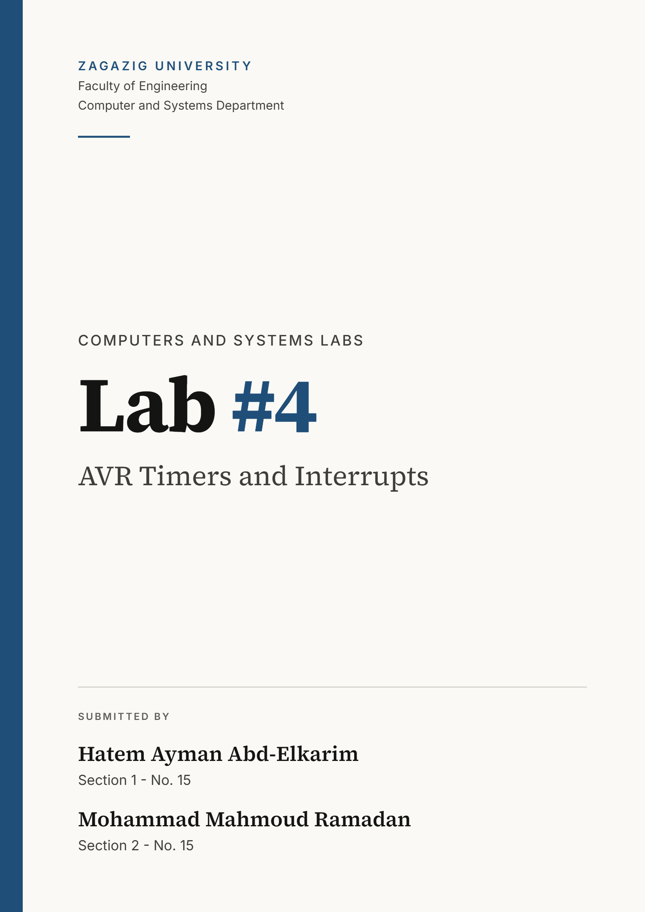

 <div style="page-break-after: always;"></div>

# AVR Timers and Interrupts

ATmega328P (Arduino Uno), `f_clk = 16 MHz`. Three timers, two buttons, three LEDs.

## Hardware

| Part | Pin | Arduino |
|---|---|---|
| LED1 - Timer0 blink | PB0 | D8 |
| LED2 - Timer1 PWM (OC1A) | PB1 | D9 |
| LED3 - debounce indicator | PB2 | D10 |
| Button 1 (INT0) | PD2 | D2 |
| Button 2 (INT1) | PD3 | D3 |

## Timer roles

| Timer | Mode | Prescaler | Job |
|---|---|---|---|
| Timer0 | CTC | 1024 | Blinks LED1. Button 1 changes `OCR0A` (blink rate) |
| Timer1 | Fast PWM 10-bit | 8 | Fades LED2. Button 2 changes `OCR1A` (duty cycle) |
| Timer2 | Normal | 1024 | 250 ms debounce lockout for both buttons |

## Calculations

Timer tick for prescaler 1024: `1024 / 16 MHz = 64 us`.

**Timer0 (CTC)**
- Compare period: `T_match = (OCR0A + 1) x 64 us`. With `OCR0A = 249`: 250 x 64 us = 16 ms.
- The ISR counts 20 matches per LED toggle: `T_toggle = 20 x T_match`.
- Button 1 does `OCR0A -= 50` and wraps to 249 below 50:

| OCR0A | T_match | Toggle every | Blink frequency |
|---|---|---|---|
| 249 | 16.0 ms | 320 ms | 1.56 Hz |
| 199 | 12.8 ms | 256 ms | 1.95 Hz |
| 149 | 9.6 ms | 192 ms | 2.60 Hz |
| 99 | 6.4 ms | 128 ms | 3.91 Hz |

**Timer1 (Fast PWM 10-bit, TOP = 1023)**
- `f_PWM = f_clk / (N x 1024) = 16 MHz / (8 x 1024) = 1953 Hz`
- `Duty = OCR1A / 1024`. Button 2 does `OCR1A += 100`, and wraps to 0 above 1023: 0, 9.8, 19.5, ... 97.7 % (100 to 1000).

**Timer2 (Normal)**
- Overflow every `256 x 64 us = 16.384 ms`.
- `250 ms / 16.384 ms = 15.26`, so 15 overflows give `15 x 16.384 = 245.76 ms` (about 250 ms).

## Code explanation

**Globals**: `t0_count` (Timer0 matches), `t2_count` (Timer2 overflows), `busy` (1 while debounce is running).

**`setup()`**
- `DDRB |= ...` sets PB0 to PB2 as outputs. `DDRD &= ~...` sets PD2 and PD3 as inputs, and `PORTD |= ...` enables their pull-ups.
- **Timer0:** `WGM01` selects CTC, `CS02`+`CS00` select prescaler 1024, `OCR0A = 249`, and `TIMSK0 = (1 << OCIE0A)` enables the compare match interrupt.
- **Timer1:** `WGM11`, `WGM10`, `WGM12` select fast PWM 10-bit, `COM1A1` selects non-inverting output on OC1A, `CS11` selects prescaler 8. No interrupt is needed; the hardware generates the PWM.
- **Timer2:** all control bits are 0 (Normal mode, stopped). `TOIE2` enables the overflow interrupt.
- **Buttons:** `ISC01` and `ISC11` select falling edge. `EIMSK` enables INT0 and INT1. `sei()` enables global interrupts.

**ISRs**
- `TIMER0_COMPA_vect` (every 16 ms): counts to 20, then resets the count and toggles PB0.
- `INT0_vect` (Button 1): if `busy == 0`, lowers `OCR0A` by 50 (wrapping to 249), resets `TCNT0` to 0 so the new compare value is not missed (CTC has no double buffering), then starts the debounce.
- `INT1_vect` (Button 2): if `busy == 0`, raises `OCR1A` by 100 (wrapping to 0), then starts the debounce.
- **Starting the debounce:** sets `busy = 1`, clears `t2_count` and `TCNT2`, writes the prescaler bits into `TCCR2B` (this starts Timer2), and turns on PB2.
- `TIMER2_OVF_vect`: after 15 overflows it stops Timer2 (`TCCR2B = 0`), sets `busy = 0`, turns off PB2, and clears `INTF0` / `INTF1` in `EIFR` so presses that bounced during the lockout are dropped.

**`loop()`**: empty. Everything is interrupt driven.

## Flow

```
Button press (falling edge) -> INT0 / INT1 ISR
    busy == 1 -> ignore
    busy == 0 -> change OCR0A (Button 1) or OCR1A (Button 2)
              -> start Timer2 (busy = 1, PB2 on)
              -> after 15 overflows (~246 ms): stop Timer2, busy = 0, PB2 off
```

Timer0 and Timer1 run continuously on their own.