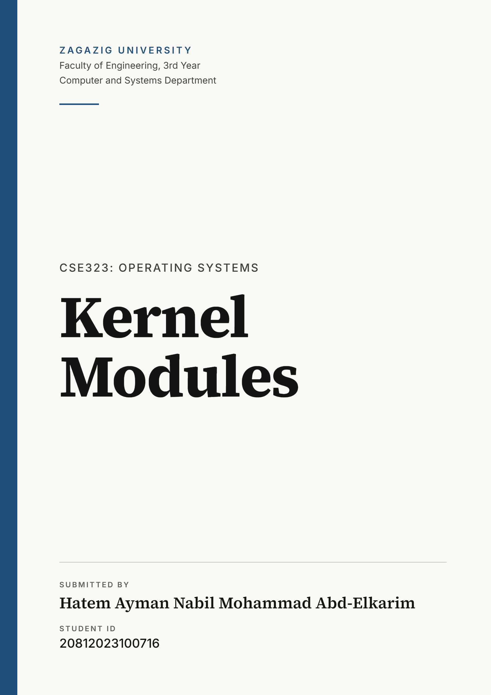 <div style="page-break-after: always;"></div>

## Objectives

The goals of this project were to become familiar with the Linux operating system and to take a first step into operating system development by writing kernel modules, loading them into the running kernel, and creating entries in the `/proc` file system.

## Environment

| Item            | Value                               |
| --------------- | ----------------------------------- |
| Host OS         | Windows                             |
| Virtualization  | Oracle VirtualBox                   |
| Guest OS        | NixOS (x86-64)                      |
| Kernel version  | 6.18.57                             |
| Compiler        | GCC 15.3.0                          |
| Text Editor     | nano                                |
| Timer frequency | `HZ = 1000` (printed by the module) |

Working inside a virtual machine means a faulty kernel module can at worst force a reboot of the VM, not of my real machine.

**Building on NixOS.** For the distro I've chosen, NixOS, it has no `/lib/modules/<version>/build` directory, so the usual Makefile does not work out of the box. I added a `shell.nix` that provides the kernel headers and build tools matching the running kernel, and exposes the path as `KDIR`. The Makefile uses `KDIR`, so the build runs inside `nix-shell`:

```
nix-shell
make
```

Screenshot of entering the Nix shell (it downloads the kernel development files the first time):

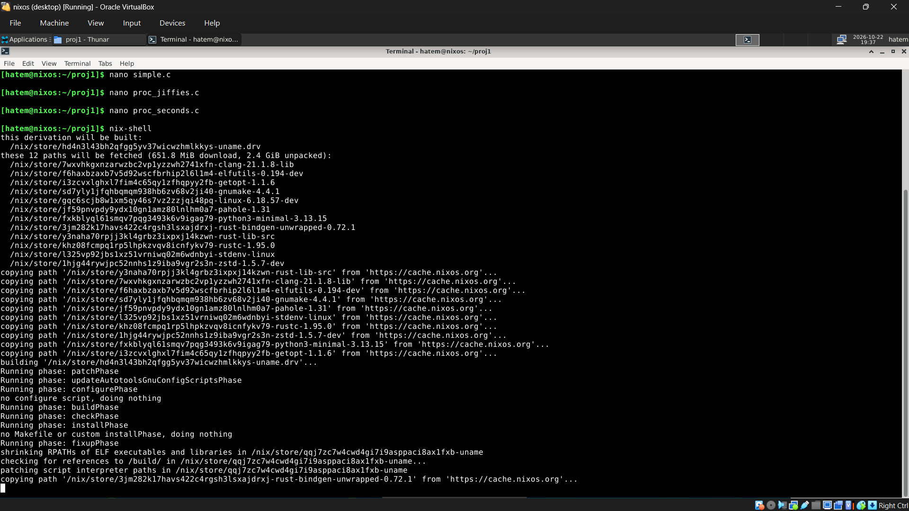

## Part I: Kernel Modules Overview

I first listed the modules loaded in the kernel with `lsmod`. The output has three columns: module name, size, and what uses the module.

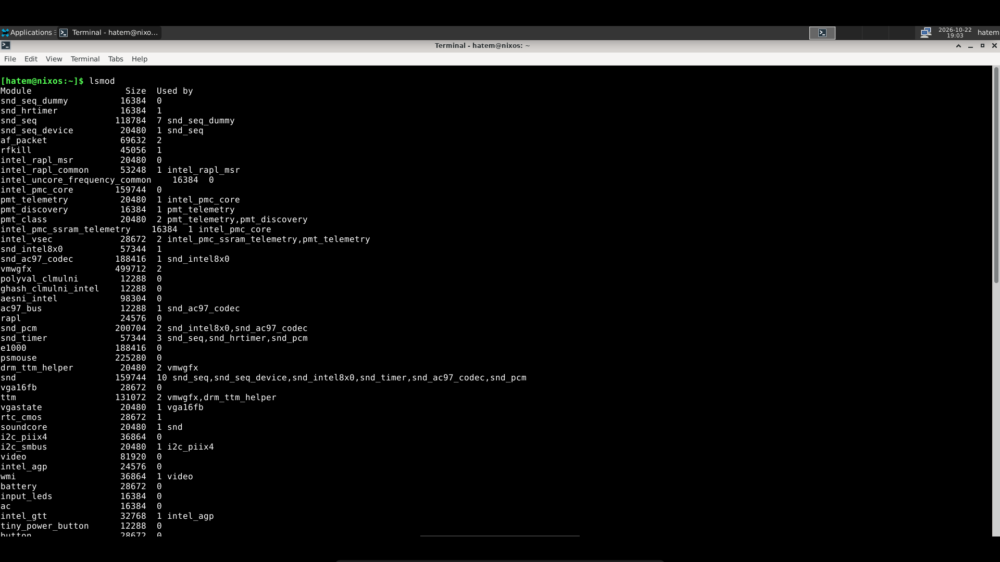

### The module source: `simple.c`

A kernel module needs an **entry point** (called when the module is loaded) and an **exit point** (called when it is removed). They are registered with the `module\\\_init()` and `module\\\_exit()` macros. The entry point returns `0` on success and takes no parameters. The module also declares license, description and author with `MODULE\\\_LICENSE`, `MODULE\\\_DESCRIPTION` and `MODULE\\\_AUTHOR`.

`printk()` is the kernel equivalent of `printf()`. Its output goes to the kernel log buffer (read with `dmesg`), and it takes a priority level such as `KERN\\\_INFO`.

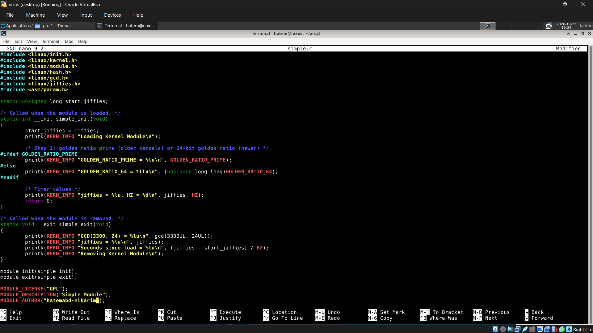

### Compiling

I compiled with `make`. The first build succeeded but produced a warning: the golden-ratio value is a 64-bit `unsigned long long` on this kernel, while I had used the format `%lu`.

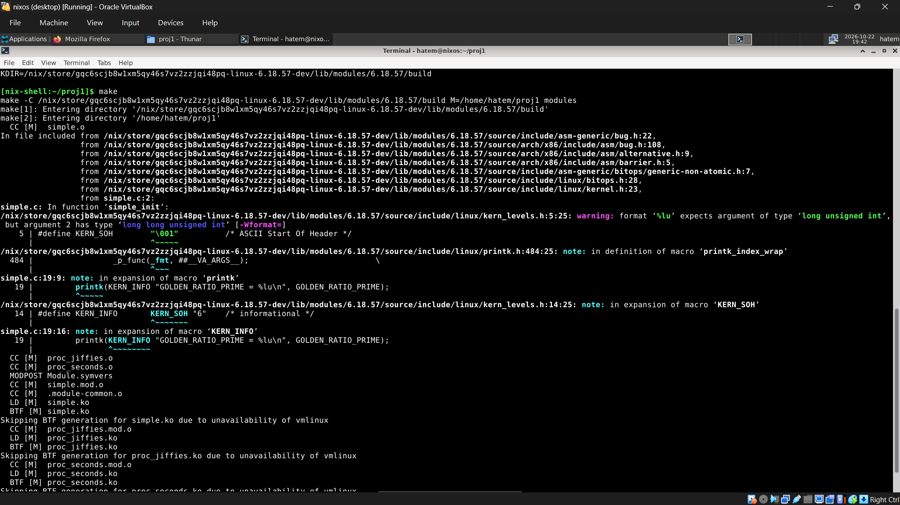

I fixed it by changing the format to `%llu` on that line (`sed -i '19s/%lu/%llu/' simple.c`) and rebuilt. The second build is clean:

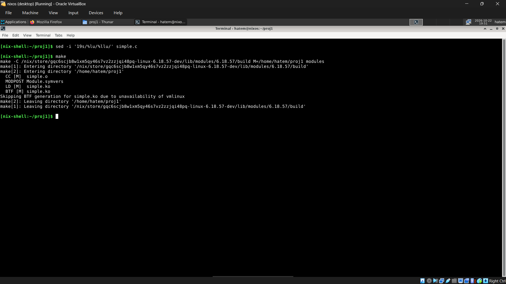

After the full build, all three `.ko` files exist (`simple.ko`, `proc\\\_jiffies.ko`, `proc\\\_seconds.ko`). I also cleared the kernel log first with `sudo dmesg -c`, which prints the old boot messages once and empties the buffer so only my module's messages remain:

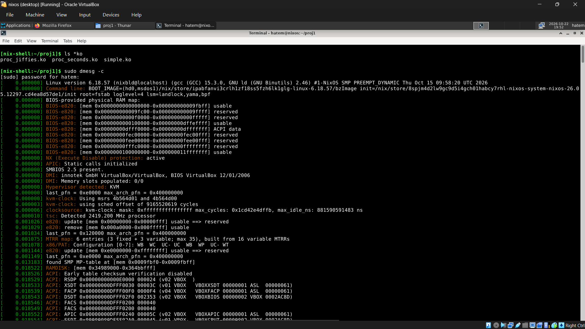

## Part II: Loading and Removing Kernel Modules

### Loading

```
lsmod | head
sudo insmod simple.ko
lsmod | grep simple
sudo dmesg
```

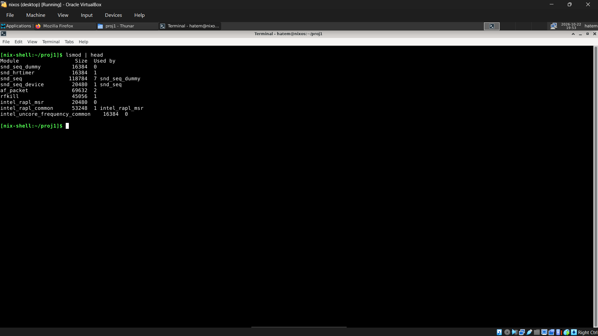

After `insmod`, `lsmod | grep simple` shows the module (size 12288, used by 0), and `dmesg` shows the messages printed by `simple\\\_init()`:

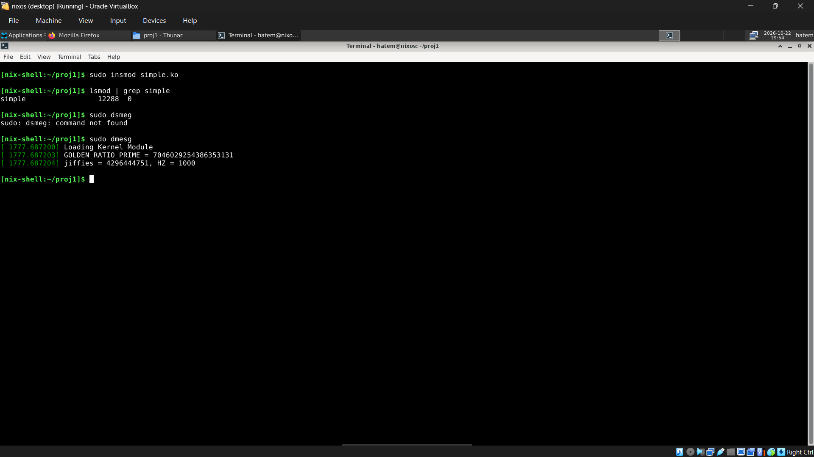

The output was:

- `Loading Kernel Module`
- `GOLDEN\\\_RATIO\\\_PRIME = 7046029254386353131`
- `jiffies = 4296444751, HZ = 1000`

### Removing

```
sudo rmmod simple
sudo dmesg
```

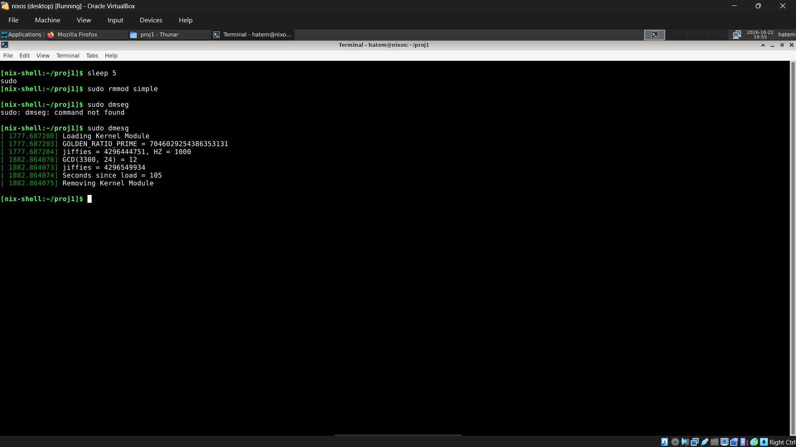

`simple\\\_exit()` printed:

- `GCD(3300, 24) = 12`
- `jiffies = 4296549934`
- `Seconds since load = 105`
- `Removing Kernel Module`

### Additional steps

1. `GOLDEN\\\_RATIO\\\_PRIME` (from `<linux/hash.h>`) is printed in `simple\\\_init()`.
2. The greatest common divisor of 3,300 and 24, computed with `gcd()` from `<linux/gcd.h>`, is printed in `simple\\\_exit()`. The result is **12**, which is correct since 3300 = 12 × 275 and 24 = 12 × 2.
3. `jiffies` and `HZ` (from `<linux/jiffies.h>` and `<asm/param.h>`) are printed in `simple\\\_init()`, and `jiffies` is printed again in `simple\\\_exit()`.

### Elapsed time from jiffies

`jiffies` counts timer interrupts since boot, and `HZ` is how many occur per second. So the time between load and removal is:

```
seconds = (jiffies\\\_at\\\_exit - jiffies\\\_at\\\_init) / HZ
```

Check with my numbers: (4296549934 − 4296444751) / 1000 = 105183 / 1000 ≈ **105 seconds**. This matches the module's own output and also the `dmesg` timestamps (1882.86 − 1777.69 ≈ 105 s). It was longer than the 5-second `sleep` because of the time I took between typing the commands.

## Part III: The /proc File System

`/proc` is a pseudo file system that exists only in kernel memory and is used to query kernel and per-process information. A module can add its own entry with `proc\\\_create()` and remove it with `remove\\\_proc\\\_entry()`.

When a user reads the file (for example with `cat`), the kernel calls the module's read function. This function builds the text in a kernel-space buffer, copies it to the user's buffer with `copy\\\_to\\\_user()`, and returns the number of bytes. It must return `0` on the next call so that `cat` knows the end of the file was reached. I used the file offset `\\\*pos` for this.

**Kernel API difference.** The textbook example uses `struct file\\\_operations` with `.owner` and `.read`. Since Linux 5.6, `/proc` entries use `struct proc\\\_ops` with `.proc\\\_read`. My modules use `proc\\\_ops`, with a version check (`LINUX\\\_VERSION\\\_CODE`) so the code also works on older kernels.

## Part IV: Assignment

### `/proc/jiffies` (`proc\\\_jiffies.c`)

The module creates `/proc/jiffies` in its init function. Each read formats the current value of `jiffies` into a buffer and copies it to user space. The exit function removes the entry.

```
sudo insmod proc\\\_jiffies.ko
cat /proc/jiffies
cat /proc/jiffies
cat /proc/jiffies
sudo rmmod proc\\\_jiffies
cat /proc/jiffies
```

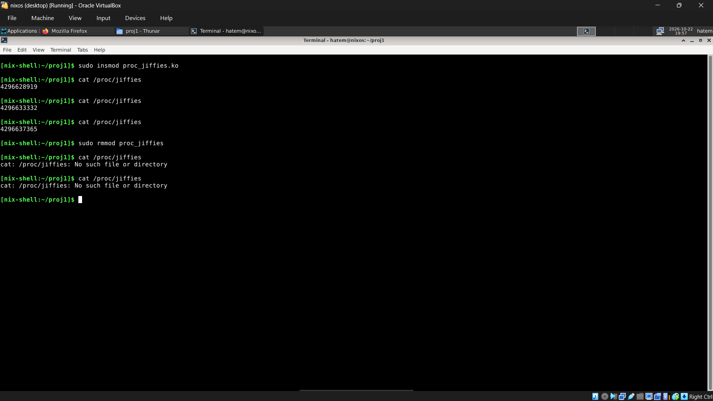

Three consecutive reads gave 4296628919, 4296633332 and 4296637365. The value increases between reads (for example 4296633332 − 4296628919 = 4413 ticks ≈ 4.4 s at `HZ = 1000`). After `rmmod`, reading the file gives `No such file or directory`, which shows the entry was removed.

### `/proc/seconds` (`proc\\\_seconds.c`)

The module saves `jiffies` into `start\\\_jiffies` when it is loaded. Each read of `/proc/seconds` reports `(jiffies - start\\\_jiffies) / HZ`, the number of seconds since the module was loaded. The entry is removed on unload.

```
sudo insmod proc\\\_seconds.ko
cat /proc/seconds
sleep 10
cat /proc/seconds
sudo rmmod proc\\\_seconds
cat /proc/seconds
```

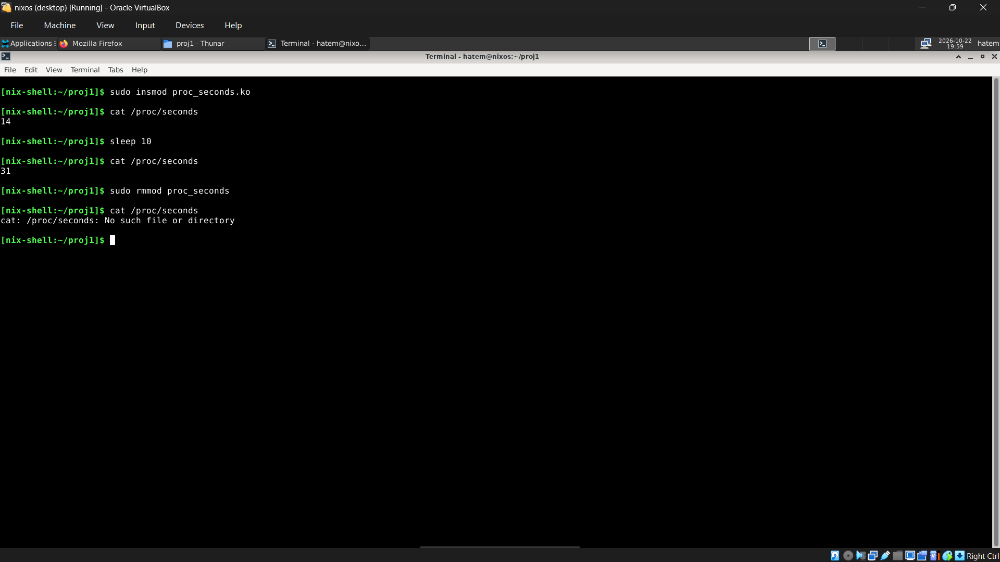

The first read printed `14` and, after the 10-second sleep (plus the time I spent typing), the second printed `31`. The numbers are larger than 0 and 10 only because of the delay between my commands; the counter increases in real time. After `rmmod`, `/proc/seconds` no longer exists.

## Cleaning Up

`make clean` removes the generated build files (`.ko`, `.o`, `.mod\\\*`, `modules.order`, `Module.symvers`), leaving only the source files, so that the submitted zip contains just the code.

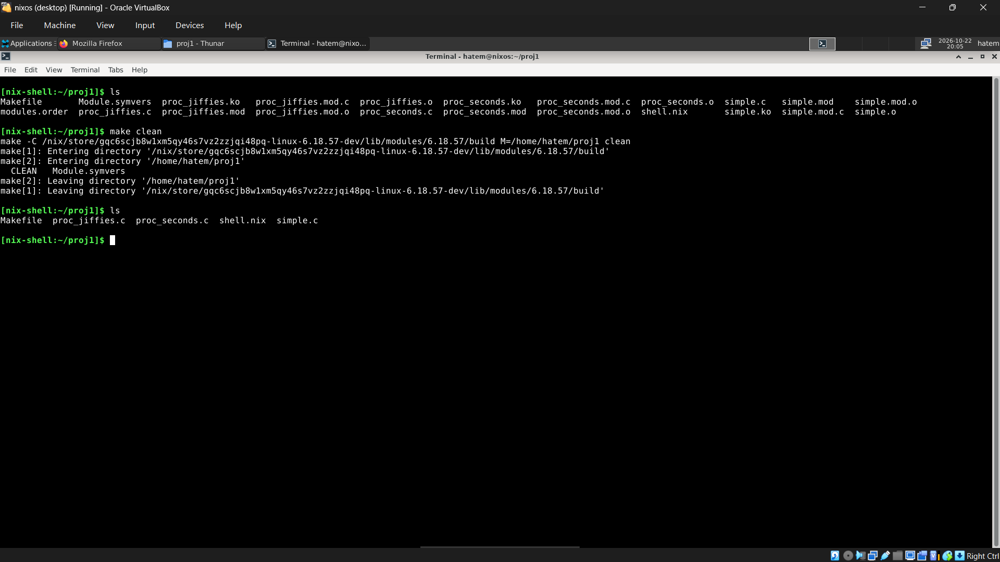

The final directory contains: `Makefile`, `proc\\\_jiffies.c`, `proc\\\_seconds.c`, `shell.nix`, `simple.c`.

## Project Takeoffs and key points learnt

- A kernel module is code that is loaded into and runs inside the running kernel, so mistakes can crash the whole system. A virtual machine is a safe place to test.
- Modules have an entry point (`module\\\_init`) and an exit point (`module\\\_exit`). Entry returns `0` for success.
- `printk` writes to the kernel log buffer, read with `dmesg`, instead of to the terminal. `lsmod`, `insmod` and `rmmod` list, load and unload modules.
- Kernel code can use kernel-only symbols and functions such as `GOLDEN\\\_RATIO\\\_PRIME`, `gcd()`, `jiffies` and `HZ`.
- `jiffies` counts timer ticks since boot and `HZ` is the tick rate, so dividing a difference of `jiffies` by `HZ` gives elapsed seconds.
- Kernel space and user space are separate, so data must be moved with `copy\\\_to\\\_user()`.
- A `/proc` entry is created with `proc\\\_create()` and must be removed with `remove\\\_proc\\\_entry()` when the module exits; a read function signals end-of-file by returning `0`.
- Kernel APIs change between versions (for example `file\\\_operations` to `proc\\\_ops`), so code from a textbook may need adapting to the running kernel.
