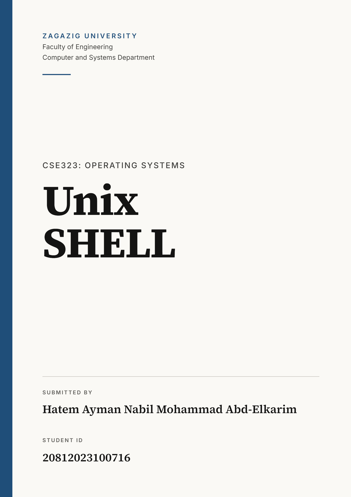
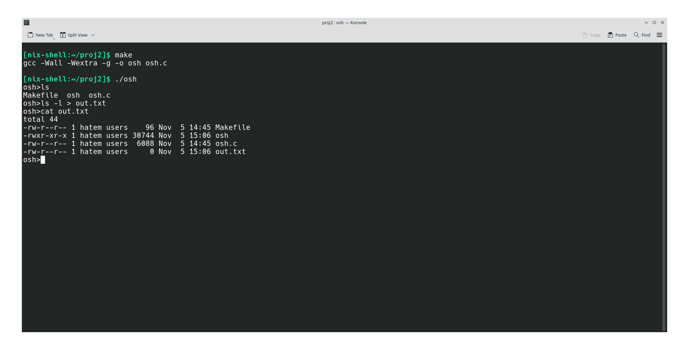
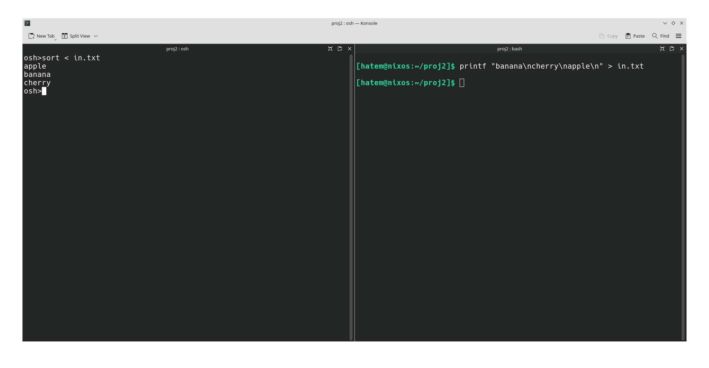
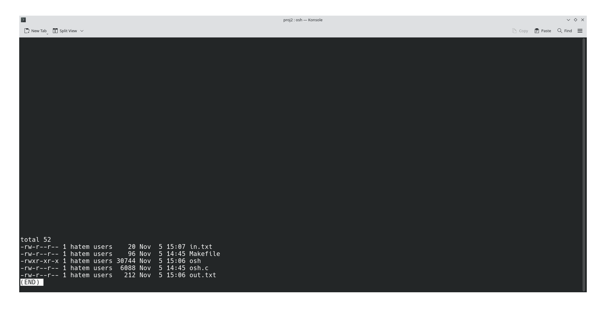
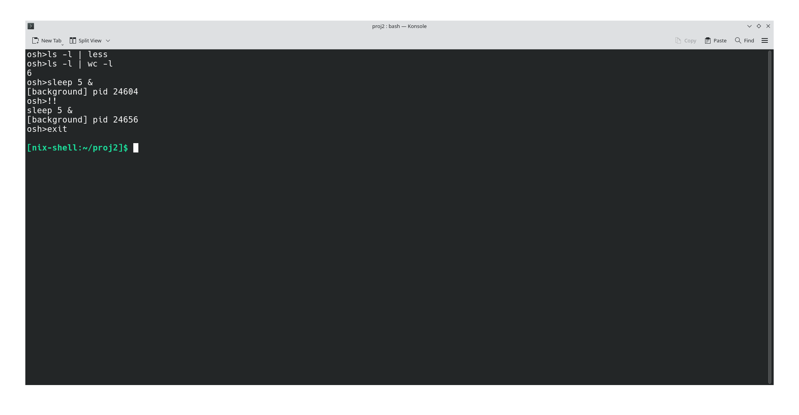
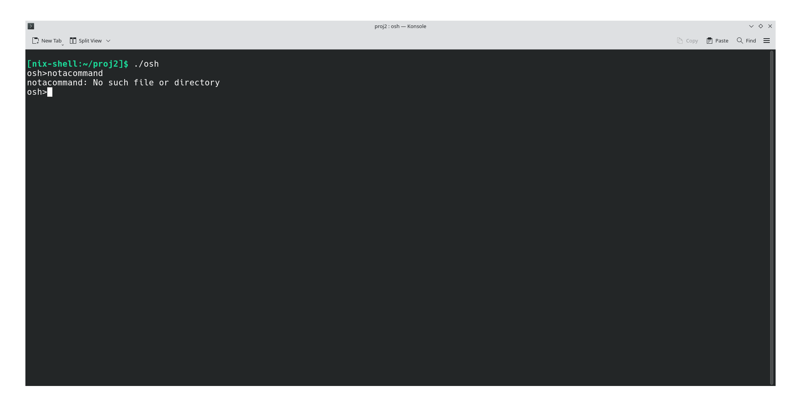
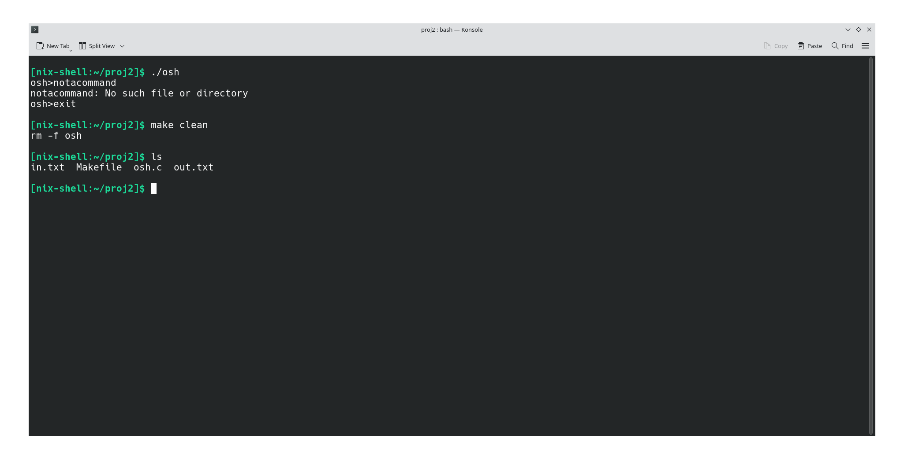

 <div style="page-break-after: always;"></div>

## Objective

The goal was to write a small shell in C. A shell is the program that shows a prompt, reads what you type, and runs it. Mine is called `osh` and its prompt is `osh>`.

It does these things:

- runs a command in a **child process** and waits for it to finish
- runs a command in the **background** if it ends with `&`
- repeats the last command when you type `!!`
- **redirects** input and output with `<` and `>`
- connects two commands with a **pipe** (`cmd1 | cmd2`)
- quits when you type `exit`

I also added `cd` as a built-in command (more on that in section 4).

## My setup

- Windows laptop, with NixOS running in VirtualBox
- Editor: I wrote the code on Windows and copied it into the VM with `scp`
- Compiler: `gcc` (NixOS does not come with it, so I used `nix-shell -p gcc gnumake`)
- Files: `osh.c` and a `Makefile`

To use:

```bash
cd ~/proj2
nix-shell -p gcc gnumake
make
./osh
```

## How the code works

### Reading a command

The main loop prints `osh>`, reads a line with `fgets`, and splits it into words with `strtok`. The words go into the `args` array, which ends with `NULL` because `execvp` needs that. If a line is longer than 80 characters, the shell prints an error and ignores it.

### Running a command: fork, exec, wait

For a normal command the shell does this:

1. `fork()` makes a child process.
2. The child calls `execvp()`, which replaces the child with the program (for example `ls`).
3. The parent calls `waitpid()` and waits until the child is done.

```c
pid_t pid = fork();
if (pid == 0)
    exec_command(args);     /* child: becomes the program */
else
    waitpid(pid, NULL, 0);  /* parent: waits */
```

If `execvp` fails (for example the command does not exist), the child prints the error and exits, and the shell keeps running.

### Background commands

If the last word is `&`, the shell removes it and the parent does **not** call `waitpid`. It just prints the child's pid and shows the prompt again. At the start of every loop the shell also calls `waitpid(-1, NULL, WNOHANG)` to clean up finished background children, so they do not stay as zombie processes.

### History (`!!`)

The shell saves the last command in a string. When I type `!!` it prints that command and runs it again. If nothing has been run yet, it says `No commands in history.`

### Redirection (`<` and `>`)

This happens in the child, before `execvp`. The shell looks for `<` or `>` in the words, opens the file after it, and uses `dup2()` to replace standard input or output with that file:

```c
fd = open(file, O_WRONLY | O_CREAT | O_TRUNC, 0644);
dup2(fd, STDOUT_FILENO);   /* now printf, ls, etc. write into the file */
close(fd);
```

After that the command runs normally and does not know its output goes to a file.

### Pipe (`|`)

When the line has a `|`, the shell splits it into a left and a right command, calls `pipe()` to get two file descriptors, and creates **two** children:

- child 1 connects its standard output to the write end of the pipe (`dup2`) and runs the left command
- child 2 connects its standard input to the read end of the pipe and runs the right command

The parent then closes both ends of the pipe and waits for both children. Closing them is important. If the parent keeps the write end open, the reader never gets "end of file" and hangs.

### Built-in commands

`exit` stops the loop. `cd` calls `chdir()` inside the shell itself. It has to be built in, because if a child ran `cd` it would only change the child's directory and then die.

## Testing

### Test 1: build, `ls`, and output redirection

I compiled with `make` (no warnings), started `./osh`, and ran `ls`. Then I ran `ls -l > out.txt`, which printed nothing on the screen because the output went into the file. `cat out.txt` shows what was saved.



One detail: `out.txt` shows size `0` in its own listing. That is normal, because the file was created before `ls` ran, so `ls` saw it empty.

### Test 2: input redirection

I made `in.txt` in a second terminal with the lines `banana`, `cherry`, `apple`. Then in `osh` I ran `sort < in.txt`. The output is sorted (apple, banana, cherry), so the file was used as the input of `sort`.



### Test 3: pipe with `less`

`ls -l | less` sends the output of `ls -l` into `less`. The screenshot shows the listing inside `less` (the `(END)` at the bottom is `less` telling me there is nothing more to show). I pressed `q` to leave.



### Test 4: pipe with `wc`, background, history, and exit

- `ls -l | wc -l` printed `6`, which matches the six lines of the listing in the last screenshot (the `total` line plus five files).
- `sleep 5 &` printed `[background] pid 24604` and the prompt came back right away, without waiting five seconds.
- `!!` printed `sleep 5 &` and ran it again with a new pid (24656).
- `exit` ended the shell and brought me back to the normal terminal.



### Test 5: a command that does not exist

`notacommand` printed `No such file or directory` and the shell kept going and showed the prompt again.



### Test 6: cleaning up

I ran `exit`, then `make clean` (it deletes the compiled `osh` file), then `ls`. Only the source files and my two test files are left.



## Problems

- **No `gcc` on NixOS.** The first time I tried to compile it was not found. I fixed it with `nix-shell -p gcc gnumake`.
- **`sort < in.txt` gave an error the first time.** The file `in.txt` did not exist yet. The shell printed `in.txt: No such file or directory`, which is the right behavior. I created the file and ran it again.
- **Zombie processes.** Background children that finish and are never waited for stay in the process table. I fixed this by calling `waitpid` with `WNOHANG` before each prompt.

## Limits of the shell

- Only one pipe in a line (the project says that is enough).
- No pipe and redirection in the same command.
- A command can be at most 80 characters.
- Quotes are not understood: the line is split on spaces, so `echo "a b"` keeps the quotes.

## Learning outcomes

- `fork()` returns `0` in the child and the child's pid in the parent, so one `if` decides who does what.
- `exec` does not create a process. It replaces the program inside the current one.
- A parent that never calls `wait` leaves zombie processes behind.
- Redirection is only `dup2` copying a file descriptor onto 0 (input) or 1 (output), and the program does not know the difference.
- A pipe has two ends, and you must close the ends you do not use. If you do not, the reader waits forever.
- Some commands, like `cd` and `exit`, have to be built into the shell and cannot be run as separate processes.
